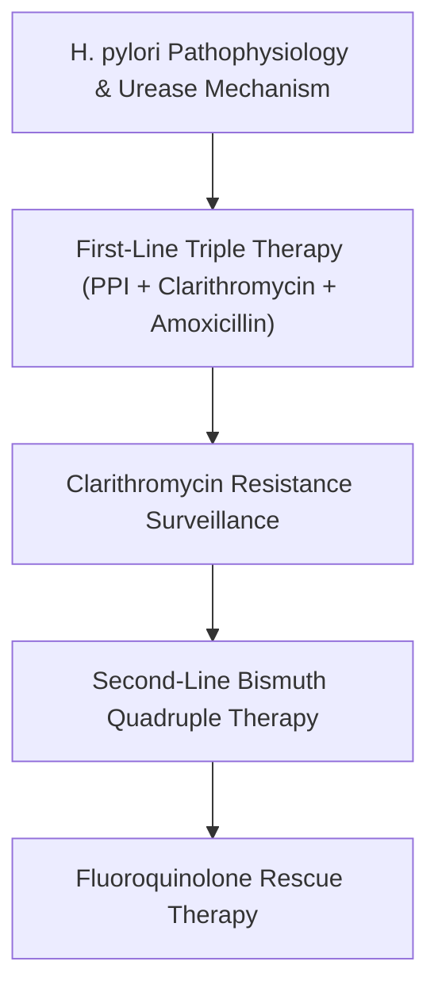
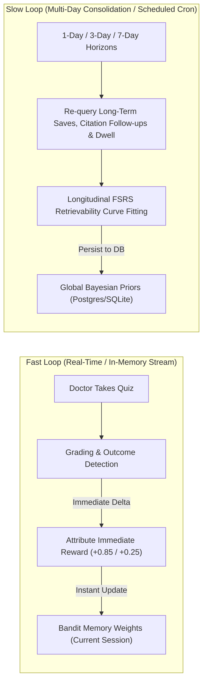

# Signal MD: Reinforcement Learning & Machine Learning Architecture Roadmap

This document outlines strategic architectural upgrades to advance Signal MD's adaptive search, personalized spaced repetition, and reinforcement learning (RL) engines from a heuristic multi-armed bandit to a state-of-the-art **Clinical Adaptive Learning & Evidence Retrieval System**.

---

## 1. Contextual Bandits (LinUCB / Linear Thompson Sampling)

### Current Architecture
Signal MD currently uses Beta-Bernoulli Thompson Sampling with discrete arms (`heuristic_default`, `recency_heavy`, `guideline_first`, `misconception_heavy`, `trial_heavy`, `review_heavy`). Contextual features (time of day, streak, mastery level) act primarily as post-hoc heuristic weights or filters.

### The Limitation
Clinical evidence needs vary drastically by context:
* An attending cardiologist searching for *"HFpEF trial outcomes"* requires deep RCT data and hazard ratios (`trial_heavy`).
* An emergency medicine resident searching for *"acute anaphylaxis dosing"* needs instant, protocol-driven guidelines (`guideline_first`).

Context-free bandits learn average performance across all queries, failing to discover which strategy is optimal for a given clinical setting.

### Proposed Upgrade: LinUCB / Contextual Thompson Sampling
Model the expected reward of an arm $a$ as a linear combination of a unified context feature vector $\mathbf{x}_t \in \mathbb{R}^d$:

$$\mathbb{E}[R_t \mid \mathbf{x}_t, a] = \mathbf{x}_t^T \boldsymbol{\theta}_a$$

Where the feature vector $\mathbf{x}_t$ includes:
1. **Query Intent Features**: Classification scores (Diagnostic Dilemma, Therapeutic Management, Landmark Search, Rare Disease).
2. **Physician Profile Features**: Specialty embedding, training stage (Medical Student, Resident, Fellow, Attending), baseline clinical experience.
3. **Cognitive State Features**: Current topic mastery score ($0.0 \dots 1.0$), current study streak, session depth.
4. **Temporal / Session Dynamics**: Elapsed time since last session, previous query reformulation count.

#### Implementation Target
* Create `server/services/bandit/contextualLinUcbService.js`.
* Maintain matrix $\mathbf{A}_a = \mathbf{I}_d + \sum_{\tau=1}^t \mathbf{x}_\tau \mathbf{x}_\tau^T$ and vector $\mathbf{b}_a = \sum_{\tau=1}^t R_\tau \mathbf{x}_\tau$ per arm.
* Fast ridge regression update: $\hat{\boldsymbol{\theta}}_a = \mathbf{A}_a^{-1} \mathbf{b}_a$.
* Arm selection rule:
  $$a_t = \arg\max_{a} \left( \hat{\boldsymbol{\theta}}_a^T \mathbf{x}_t + \alpha \sqrt{\mathbf{x}_t^T \mathbf{A}_a^{-1} \mathbf{x}_t} \right)$$

---

## 2. Position Debiasing via Inverse Propensity Scoring (IPS)

### Current Architecture
Clicks, reading dwell times ($\ge 30\text{s}$), and library saves directly contribute positive rewards to the ranking arm that produced the result set.

### The Limitation (Position Bias)
In clinical search interfaces, users have an innate bias toward clicking and examining the **first two items** displayed, regardless of true relevance. Without counteracting position bias, the bandit artificially over-rewards whichever arm happens to place *any* moderately relevant paper at Position 1.

### Proposed Upgrade: Inverse Propensity Weighting (IPW)
De-bias observed interactions by the estimated examination propensity $P(\text{examine} \mid \text{position } k)$:

$$R_{\text{debiased}}(u, k) = \frac{R_{\text{observed}}(u, k)}{P(\text{examine} \mid k)}$$

Estimated baseline examination probabilities (calibrated via randomized intervention slots):
* Position 1: $1.00$
* Position 2: $0.72$
* Position 3: $0.51$
* Position 4: $0.38$
* Positions 5–10: $0.20 \dots 0.08$

#### Clinical Impact
* A save on an article placed at **Position 7** indicates strong physician intent and relevance; it receives a large positive weight ($\approx \times 5.0$).
* A casual click at **Position 1** receives standard normalized weight ($\times 1.0$).
* Protects the bandit from gravitating toward sensational trial titles that capture cheap clicks at the top of the viewport.

---

## 3. Safe RL & Constrained Markov Decision Processes (CMDP)

### Current Architecture
Interaction rewards and quiz outcomes are linearly scalarized:
$$\text{Reward} = 0.1 \times R_{\text{impression}} + 0.9 \times R_{\text{quiz}}$$

### The Clinical Risk
Commercial recommender systems optimize purely for engagement (clicks, dwell time, screen interaction). In medicine, maximizing dwell time could inadvertently promote dense, outdated, or controversial studies over clear, current guidelines.

### Proposed Upgrade: Constrained Optimization with Clinical Guardrails
Formulate ranking optimization as a Constrained MDP (CMDP) using Lagrangian relaxation:

$$\max_{\pi} \mathbb{E}_{\pi} \left[ R_{\text{learning}} \right] \quad \text{subject to} \quad \mathbb{P}_{\pi}\left(\text{outdated source in top 3}\right) \le \epsilon_{\text{safety}}$$

#### Concrete Guardrails
1. **Guideline Prerequisite Constraint**: If a query is identified as therapeutic management and an accredited clinical practice guideline ($\le 5$ years old) is available, any ranking arm that fails to place a guideline in the top 3 suffers a mandatory reward penalty:
   $$\text{Penalty}_{\text{safety}} = -0.50$$
2. **Retracted Paper Filter**: Hard zero probability; immediate quarantine from the retrieval pool.
3. **Contradiction Dampener**: If an article presents findings directly superseded by subsequent consensus, downweight unless explicitly querying controversial evidence.

---

## 4. Graph-Based Curriculum RL (Hierarchical Medical Knowledge Graph)

### Current Architecture
The Free Spaced Repetition Scheduler (FSRS) schedules individual outline cards and claims independently based on single-item repetition history.

### The Limitation
Medical knowledge is deeply hierarchical and cumulative:
$$\text{Pathophysiology} \longrightarrow \text{First-line Diagnostics} \longrightarrow \text{Initial Therapy} \longrightarrow \text{Refractory Management}$$

If a doctor misses a practice question on *"Second-line quadruple therapy for refractory H. pylori"*, simply repeating that exact card fails to address the root gap (e.g., lack of clarity on *clarithromycin resistance mutations*).

### Proposed Upgrade: Prerequisite Knowledge Graph Traversal
Connect FSRS cards using a Directed Acyclic Graph (DAG) derived from MeSH / SNOMED-CT clinical ontologies.

#### Adaptive Remediation Logic
* **On High-Confidence Error**: When a user selects a wrong answer with high stated confidence on node $D$, the RL agent:
  1. Identifies parent prerequisite node $C$.
  2. Inserts a diagnostic calibration MCQ on node $C$ into the next practice batch.
  3. Re-schedules the target scenario $D$ only after prerequisite competence is re-established.

---

## 5. Dual-Speed Learning Architecture (Fast Online + Slow Nightly)

### Current Architecture
The delayed reward backfill engine runs once every 24 hours at 04:15 UTC via `node-cron`.

### Proposed Upgrade: Hybrid Streaming & Batch Optimization
Split the feedback engine into two synchronized loops:

* **Immediate Benefits**:
  * If a physician searches a topic and immediately tests themselves on the practice MCQs, the search arm receives credit in seconds, immediately tuning subsequent searches within that same session.
  * Long-term memory consolidation (3-day and 7-day recall) continues to be handled robustly by the background scheduler.

---

## 6. Active Learning / Uncertainty-Guided Question Sampling

### Current Architecture
MCQ presentation relies on either cold-start random sampling or cards that are due for FSRS review.

### Proposed Upgrade: Bayesian Active Learning by Disagreement (BALD)
Instead of testing arbitrary due cards, select the clinical question that maximizes information gain regarding the physician's knowledge frontier:

$$\mathcal{I}(y; \boldsymbol{\theta} \mid x) = \mathbb{H}[y \mid x, \mathcal{D}] - \mathbb{E}_{p(\boldsymbol{\theta} \mid \mathcal{D})}[\mathbb{H}[y \mid x, \boldsymbol{\theta}]]$$

* Prioritizes testing on claims where the model's epistemic uncertainty is highest.
* Respects the physician's limited time: achieves accurate mastery estimation in **4 to 5 targeted questions** rather than requiring 15–20 broad questions.

---

## Implementation Roadmap & Milestone Plan

| Phase | Module | Key Deliverables | Effort |
| :---: | :--- | :--- | :---: |
| **Phase 1** | **Inverse Propensity Scoring** | Implement position debiasing in `server/services/rewardAttributionService.js` and `delayedRewardBackfillService.js`. | 1–2 days |
| **Phase 2** | **Dual-Speed Online Updates** | Trigger immediate partial reward updates on quiz completion events in `server/routes/learning/quiz.js`. | 2–3 days |
| **Phase 3** | **Contextual LinUCB Bandit** | Build `contextualLinUcbService.js` to replace discrete Thompson sampling for multi-source search reranking. | 4–5 days |
| **Phase 4** | **Curriculum Knowledge Graph** | Map outline nodes to medical prerequisite trees; implement parent-node remediation on high-confidence errors. | 1–2 weeks |
| **Phase 5** | **Active Learning Sampling** | Deploy uncertainty-guided question selection in `server/services/learning/learningAgentService.js`. | 1 week |

---
*Document Version: 1.0 — Generated October 2026 for Signal MD Engine.*
